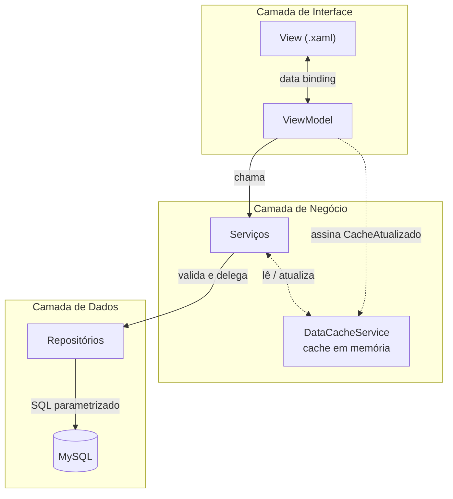

# Arquitetura do sistema

## Visão geral

O TCC Assiduidade é uma aplicação **desktop Windows**, construída em **WPF**
(Windows Presentation Foundation) sobre **.NET Framework 4.7.2**, que se conecta
a um banco de dados **MySQL** hospedado na nuvem. A aplicação segue o padrão de
arquitetura **MVVM (Model-View-ViewModel)**, organizado em camadas adicionais de
serviço e acesso a dados, resultando nesta pilha:

```
View (XAML)  <──binding──>  ViewModel  ──chama──>  Serviço  ──chama──>  Repositório  ──SQL──>  MySQL
```

Cada seta representa uma direção de dependência: a View conhece o ViewModel, o
ViewModel conhece o Serviço, o Serviço conhece o Repositório — mas nunca o
contrário. Isso é o que permite, por exemplo, trocar a interface visual inteira
sem tocar em uma linha de regra de negócio, ou trocar o banco de dados sem
mexer nas telas.

## As camadas, pasta por pasta

### `Modelos/`
Classes puras de dados (sem lógica), divididas em três propósitos diferentes:

- **`Modelos/Banco/`** — o **Model** do MVVM: `Aluno`, `Turma`, `Aula`,
  `Ausencia`. Cada classe espelha, campo a campo, uma tabela do banco de dados
  (ver [03-banco-de-dados-e-relacionamentos.md](03-banco-de-dados-e-relacionamentos.md)).
- **`Modelos/DTO/`** (*Data Transfer Object*) — `AlunoExibicaoDTO`,
  `TurmaExibicaoDTO`, `AulaExibicaoDTO`. São "visões" combinadas dos dados,
  montadas especificamente para preencher uma tela — por exemplo,
  `AlunoExibicaoDTO` já vem com o nome da turma e os totais de frequência
  calculados, prontos para exibir, em vez de forçar a tela a juntar várias
  tabelas sozinha.
- **`Modelos/Relatorios/`** e **`Modelos/Resultados/`** — formatos de saída de
  operações específicas: `RelatorioFrequencia`, `RelatorioAusente` (dados para
  os relatórios em HTML) e `ResultadoImportacaoCadastro` /
  `ResultadoImportacaoPresenca` (o resultado de uma importação de CSV, com um
  sinalizador `Sucesso` e uma `Mensagem`, em vez de lançar uma exceção — ver
  a seção "Dois estilos de erro" em
  [04-fluxo-de-dados-e-regras-de-negocio.md](04-fluxo-de-dados-e-regras-de-negocio.md)).
- **`Modelos/Dashboard/`** — registros normalizados de presença, opções dos
  filtros, pontos de gráfico e resultados calculados para os dashboards de
  alunos, aulas e turmas (ver
  [06-dashboards-e-geracao-de-graficos.md](06-dashboards-e-geracao-de-graficos.md)).

### `Repositories/`
A **única** camada que sabe falar SQL. Os repositórios de cadastro
(`AlunoRepository`, `TurmaRepository`, `AulaRepository` e
`AusenciaRepository`) abrem uma `MySqlConnection`, montam comandos
parametrizados (`MySqlCommand` com `@parametros`, nunca concatenação de string
— o que evita *SQL Injection*) e devolvem objetos de `Modelos/Banco/`.
`DashboardRepository` segue a mesma fronteira arquitetural, mas executa uma
consulta analítica sem entradas do usuário e devolve objetos de
`Modelos/Dashboard/`. Nenhuma outra camada do sistema contém uma linha de SQL.

Operações que alteram mais de uma tabela ao mesmo tempo (por exemplo, excluir
um aluno e suas faltas) usam uma **transação** (`conn.BeginTransaction()`), para
garantir que, se algo falhar no meio do caminho, nada fica gravado pela metade
— voltamos a este ponto em detalhe em
[03-banco-de-dados-e-relacionamentos.md](03-banco-de-dados-e-relacionamentos.md).

Desde a revisão de integridade de dados, todos os repositórios traduzem
qualquer `MySqlException` para uma exceção de domínio específica através do
`MySqlExceptionTranslator`, tanto em gravações quanto em consultas (ver
[05-tratamento-de-erros-e-testes.md](05-tratamento-de-erros-e-testes.md)).

### `Servicos/`
A camada de **regras de negócio**. É aqui que moram as validações ("a
matrícula não pode estar vazia", "a data da aula não pode ser futura", "já
existe uma turma com esse nome") e a orquestração de operações mais complexas.
Um Serviço nunca fala SQL diretamente — ele sempre delega ao Repositório
correspondente depois de validar os dados.

Serviços de destaque:

- **`AlunoService`, `TurmaService`, `AulaService`, `AusenciaService`** —
  um serviço por entidade, com validação + CRUD.
- **`ImportacaoService`** — orquestra a importação de CSV, que envolve vários
  outros serviços ao mesmo tempo (ver
  [04-fluxo-de-dados-e-regras-de-negocio.md](04-fluxo-de-dados-e-regras-de-negocio.md)).
- **`ArquivoService`** — leitura genérica de arquivos CSV (não sabe nada sobre
  alunos ou turmas, só sabe transformar um `.csv` em uma lista de dicionários
  texto→texto).
- **`RelatorioService`** — monta o HTML dos relatórios exportáveis.
- **`DashboardService`** — transforma os registros de frequência em métricas,
  rankings e séries temporais; `DashboardHtmlService` recria essas
  visualizações em HTML, CSS e SVG para exportação.
- **`DataCacheService`** — um **cache estático em memória** (ver seção
  própria abaixo).
- **`WindowService`** — abre as janelas de popup (cadastro, edição) de forma
  centralizada.

### `ViewModel/`
A ponte entre a tela e o serviço. Cada tela tem um ViewModel correspondente
(`TurmasViewModel`, `AlunosViewModel`, `NovoAlunoViewModel` etc.), responsável
por:

1. Expor **propriedades públicas** que a tela lê via *data binding* (a lista
   de turmas, o texto digitado na busca, o item selecionado na grade...).
2. Expor **comandos** (`ICommand`) que a tela dispara quando o usuário clica
   em um botão.
3. Chamar o Serviço correspondente e tratar o resultado — sucesso, mostrar
   mensagem de confirmação; erro, mostrar mensagem de erro apropriada.

Todo ViewModel herda de `ViewModel/Base/BaseViewModel`, que implementa
`INotifyPropertyChanged` (o mecanismo que avisa a tela "este dado mudou, se
redesenhe") e centraliza a exibição de erros (`MostrarErro`). Os comandos são
implementados pela classe `ViewModel/Base/RelayCommand`, explicada em detalhe
em [02-data-binding-e-mvvm.md](02-data-binding-e-mvvm.md).

### `View/`
As telas em si: arquivos `.xaml` (a interface declarativa) mais o seu
`.xaml.cs` (o *code-behind*). Nesta aplicação, o *code-behind* tem uma
responsabilidade deliberadamente mínima: **apenas** instanciar o ViewModel e
atribuí-lo a `DataContext`. Toda a lógica de UI acontece via *binding*, não via
manipulação direta de controles em C#. Isso é o coração do MVVM: a View "burra"
só mostra o que o ViewModel expõe.

```csharp
// View/TurmasView.xaml.cs — o padrão se repete em praticamente toda View do sistema
public partial class TurmasView : UserControl
{
    private readonly TurmasViewModel _viewModel;
    public TurmasView()
    {
        InitializeComponent();
        _viewModel = new TurmasViewModel();
        this.DataContext = _viewModel;   // a partir daqui, o XAML "enxerga" o ViewModel
    }
}
```

- **`View/Popups/`** — janelas modais de cadastro/edição (`NovoAluno`,
  `EditarTurma`, `ImportarCadastro`...).
- **`View/Relatórios/`** — as três sub-telas da Central de Relatórios.
- **`View/Dashboards/`** — a central e as três telas analíticas; os gráficos
  usados por elas são controles próprios em `View/Controls/`.
- **`View/Converters/`** — conversores de valor usados no *binding* (ver
  [02-data-binding-e-mvvm.md](02-data-binding-e-mvvm.md)).
- **`View/ANTIGO/`** — telas de uma versão anterior do sistema, mantidas no
  repositório apenas como histórico; não fazem parte do fluxo atual do
  aplicativo (não estão referenciadas em nenhuma navegação).

### `Excecoes/`
Exceções de domínio próprias do sistema (`RegistroDuplicadoException`,
`IntegridadeReferencialException`, `RegistroNaoEncontradoException`,
`ConexaoBancoDadosException`), criadas para que cada tipo de falha possa ser
comunicado ao usuário com uma mensagem específica. Detalhado em
[05-tratamento-de-erros-e-testes.md](05-tratamento-de-erros-e-testes.md).

### `TCC-Assiduidade.Testes/`
Projeto separado de testes automatizados (MSTest), que valida as regras de
negócio e a tradução de erros sem depender de uma conexão real com o banco.
Também documentado em
[05-tratamento-de-erros-e-testes.md](05-tratamento-de-erros-e-testes.md).

## O "shell" da aplicação e a navegação

A janela principal é `View/BaseWindow.xaml` (menu lateral + área de conteúdo).
Diferente das outras trocas de tela do sistema (que usam *data binding*, ver o
próximo documento), a navegação **entre as cinco seções principais** (Início,
Turmas, Alunos, Relatórios e Dashboards) é feita diretamente no *code-behind* de
`BaseWindow`, trocando o `Content` de um `ContentControl`:

```csharp
// View/BaseWindow.xaml.cs
private void TrocarConteudoPrincipal(UserControl novaView, Button botaoClicado)
{
    ConteudoPrincipal.Content = novaView;   // troca a tela inteira
    AlternarBotaoAtivo(botaoClicado);       // realça o botão do menu ativo
}
private void BtnTurmas_Click(object sender, RoutedEventArgs e) =>
    TrocarConteudoPrincipal(new TurmasView(), BtnTurmas);
```

Já **dentro** da tela de Relatórios, a navegação entre as três sub-telas
(Alunos/Aulas/Turmas) já é feita via *binding*, através da propriedade
`ConteudoAtual` do `RelatoriosViewModel` — uma mistura pragmática das duas
abordagens que convive no mesmo sistema. Essa diferença é comentada com mais
detalhe em [02-data-binding-e-mvvm.md](02-data-binding-e-mvvm.md).

A Central de Dashboards repete esse segundo padrão: `DashboardsViewModel`
mantém uma propriedade `ConteudoAtual` e a troca, por comando, entre os
dashboards de alunos, aulas e turmas. Os detalhes desse fluxo estão em
[06-dashboards-e-geracao-de-graficos.md](06-dashboards-e-geracao-de-graficos.md).

## O cache em memória (`DataCacheService`)

Em vez de cada tela consultar o banco de dados toda vez que é aberta, o
sistema carrega os dados **uma única vez**, em segundo plano, assim que o
aplicativo inicia:

```csharp
// App.xaml.cs
protected override void OnStartup(StartupEventArgs e)
{
    base.OnStartup(e);
    DataCacheService.InicializarCargaBackground();   // dispara a carga assíncrona
}
```

O `DataCacheService` é uma classe **estática** (existe uma única instância
para todo o programa, sem precisar ser passada de tela em tela) que guarda em
memória as listas de alunos, turmas e aulas já prontas para exibição. Quando
uma tela precisa desses dados, ela primeiro espera o carregamento terminar
(`while (!DataCacheService.IsCarregado) await Task.Delay(100);`) e depois lê
diretamente da propriedade estática — sem nova ida ao banco.

Sempre que um cadastro é criado, editado ou excluído, o ViewModel chama
`DataCacheService.ForçarAtualizacaoAsync()`, que busca os dados atualizados no
banco novamente e dispara o evento estático `CacheAtualizado`. **Todas** as
telas abertas que dependem daquele dado estão inscritas nesse evento e se
atualizam sozinhas — é assim que, por exemplo, cadastrar um aluno na tela de
Início atualiza imediatamente a listagem na tela de Alunos, mesmo que ela já
estivesse aberta antes do cadastro.

```csharp
// Padrão repetido em quase todo ViewModel que lista dados
DataCacheService.CacheAtualizado += OnCacheAtualizado;

private void OnCacheAtualizado()
{
    // Dispatcher.Invoke: o evento pode disparar de uma thread de segundo
    // plano, mas só a thread da interface pode alterar propriedades ligadas
    // à tela — por isso o "salto" explícito de volta para a UI thread.
    Application.Current.Dispatcher.Invoke(() =>
    {
        _listaOriginalDoBanco = DataCacheService.TurmasCache ?? new List<TurmaExibicaoDTO>();
        ExecutarBusca();
    });
}
```

## Diagrama resumido das camadas



## Por que essa separação importa

- **Testabilidade**: como visto em
  [05-tratamento-de-erros-e-testes.md](05-tratamento-de-erros-e-testes.md), é
  possível testar as regras de validação dos Serviços sem precisar de um
  banco de dados de verdade, justamente porque a regra de negócio está isolada
  da View e do Repositório.
- **Manutenção**: um bug na exibição (ex.: a cor errada num botão) nunca vai
  estar escondido no meio de uma regra de negócio, porque eles moram em
  arquivos — e camadas — diferentes.
- **Reuso**: `ArquivoService.LerCsv` não sabe nada sobre alunos; poderia ser
  reaproveitado para importar qualquer outro tipo de CSV no futuro.
