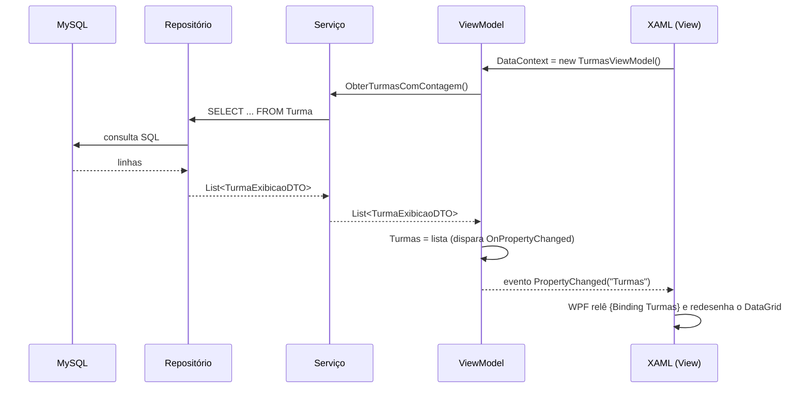
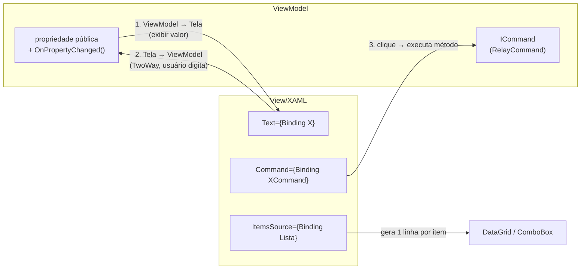

# Data binding: o que é e como preenche as telas do sistema

## O que é *data binding*

*Data binding* ("vínculo de dados") é o mecanismo do WPF que **conecta** uma
propriedade de um objeto em C# (o ViewModel) a uma propriedade visual de um
controle na tela (XAML) — de forma que, quando o valor muda de um lado, o
outro lado se atualiza **sozinho**, sem que o programador precise escrever
`textBox1.Text = valor` manualmente em nenhum lugar.

Sem *data binding*, preencher uma tela seria assim (código que **não existe**
neste projeto, mas que existiria numa aplicação Windows Forms tradicional):

```csharp
// Como seria SEM data binding (não é o que o sistema faz)
lblNome.Content = aluno.Nome;
txtEmail.Text = aluno.Email;
gridTurmas.DataSource = listaDeTurmas;
gridTurmas.DataBind();
```

Com *data binding*, a tela declara, no XAML, **de onde** cada valor vem — e o
WPF cuida de ler esse valor, escrevê-lo no controle, e ficar de olho em
qualquer mudança futura:

```xml
<!-- Como o sistema realmente faz -->
<TextBox Text="{Binding Nome}" />
<DataGrid ItemsSource="{Binding Turmas}" />
```

Esse "ficar de olho" só é possível porque o ViewModel implementa a interface
`INotifyPropertyChanged`, explicada a seguir.

## A peça-chave: `INotifyPropertyChanged`

Para que o WPF saiba que uma propriedade mudou (e precise redesenhar a tela),
o objeto de origem precisa avisar explicitamente através do evento
`PropertyChanged`. É exatamente isso que `BaseViewModel` (herdada por **todo**
ViewModel do sistema) implementa:

```csharp
// ViewModel/Base/BaseViewModel.cs
public class BaseViewModel : INotifyPropertyChanged
{
    public event PropertyChangedEventHandler PropertyChanged;

    protected void OnPropertyChanged([CallerMemberName] string propertyName = null)
    {
        PropertyChanged?.Invoke(this, new PropertyChangedEventArgs(propertyName));
    }
}
```

E toda propriedade exposta por um ViewModel segue o mesmo padrão: um campo
privado guarda o valor de verdade, e o `set` da propriedade pública, além de
atualizar o campo, dispara `OnPropertyChanged()`:

```csharp
// ViewModel/TurmasViewModel.cs
private IEnumerable<TurmaExibicaoDTO> _turmas;
public IEnumerable<TurmaExibicaoDTO> Turmas
{
    get => _turmas;
    set { _turmas = value; OnPropertyChanged(); }   // avisa a tela: "Turmas mudou"
}
```

`[CallerMemberName]` faz o compilador preencher `propertyName` automaticamente
com o nome da propriedade que chamou o método (`"Turmas"`, neste caso) — por
isso quase nunca é preciso digitar o nome da propriedade na mão.

**O ciclo completo**, do banco de dados até o pixel na tela:



## `DataContext`: de onde o `{Binding ...}` "puxa" o valor

Toda expressão `{Binding NomeDaPropriedade}` procura essa propriedade no
`DataContext` do controle — e cada controle, se não define o seu próprio,
herda o `DataContext` do seu "pai" na árvore visual. Como o *code-behind* de
cada tela define `this.DataContext = _viewModel` uma única vez, na raiz da
tela, **qualquer** controle dentro dela já consegue usar `{Binding
PropriedadeDoViewModel}` sem precisar reconfigurar nada.

```csharp
// View/Popups/NovoAluno.xaml.cs
public NovoAluno()
{
    InitializeComponent();
    this.DataContext = new NovoAlunoViewModel(this.Close);
}
```

## Os tipos de *binding* usados no sistema

### 1. Texto simples (`OneWay`, o padrão para exibição)

Mostra um valor calculado, sem que o usuário o edite diretamente:

```xml
<TextBlock Text="Total de Ausentes:" />
<TextBlock Text="{Binding TotalAusentes}" />
```

### 2. Caixa de texto editável (`TwoWay`)

Quando o usuário **digita**, o valor precisa voltar para o ViewModel — por
isso o `Mode=TwoWay` (que, em controles editáveis como `TextBox`, já é o
padrão implícito do WPF, mas o projeto costuma declará-lo explicitamente por
clareza):

```xml
<!-- View/Popups/NovoAluno.xaml -->
<TextBox Text="{Binding Matricula, UpdateSourceTrigger=PropertyChanged}"/>
```

`UpdateSourceTrigger=PropertyChanged` é o detalhe que faz a propriedade do
ViewModel ser atualizada **a cada tecla digitada**, em vez de esperar o campo
perder o foco (o padrão do WPF para `TextBox.Text`). Isso é o que permite,
por exemplo, que a busca da tela de Turmas filtre a grade em tempo real:

```csharp
// ViewModel/TurmasViewModel.cs
public string TextoBusca
{
    get => _textoBusca;
    set
    {
        _textoBusca = value;
        OnPropertyChanged();
        ExecutarBusca();      // refiltra a lista a cada letra digitada
    }
}
```

### 3. Listas e grades (`ItemsSource`)

Um `DataGrid` (ou `ComboBox`) não recebe os dados linha a linha — ele recebe a
**coleção inteira** de uma vez em `ItemsSource`, e o WPF gera as linhas (ou os
itens do combo) automaticamente, uma por elemento da lista:

```xml
<!-- View/TurmasView.xaml -->
<DataGrid ItemsSource="{Binding Turmas}"
          SelectedItem="{Binding TurmaSelecionada, Mode=TwoWay}">
    <DataGrid.Columns>
        <DataGridTextColumn Header="NOME" Binding="{Binding Nome}"/>
        <DataGridTextColumn Header="N° DE ALUNOS" Binding="{Binding QuantidadeAlunos}"/>
    </DataGrid.Columns>
</DataGrid>
```

Aqui há dois níveis de *binding* acontecendo ao mesmo tempo, e é importante
não confundi-los:

- `ItemsSource="{Binding Turmas}"` olha para o `DataContext` da **tela**
  (o `TurmasViewModel`) e pega a propriedade `Turmas` (uma lista de
  `TurmaExibicaoDTO`).
- `Binding="{Binding Nome}"`, dentro de cada coluna, olha para o
  `DataContext` da **linha** — que o próprio `DataGrid` troca automaticamente
  para cada item da lista. Ou seja, dentro de uma linha, `{Binding Nome}`
  significa "a propriedade `Nome` *deste* `TurmaExibicaoDTO`", não mais a do
  ViewModel da tela.

`SelectedItem="{Binding TurmaSelecionada, Mode=TwoWay}"` mantém o ViewModel
sempre sabendo qual linha está selecionada — é assim que os botões de editar
e excluir sabem *qual* turma operar.

### 4. `ComboBox` com objetos completos

```xml
<!-- View/Popups/NovoAluno.xaml -->
<ComboBox ItemsSource="{Binding Turmas}"
          SelectedItem="{Binding TurmaSelecionada, Mode=TwoWay}"
          DisplayMemberPath="Nome"/>
```

O `ComboBox` guarda o objeto `Turma` **inteiro** selecionado (não apenas o
texto) em `TurmaSelecionada` — `DisplayMemberPath="Nome"` só decide *qual
propriedade* do objeto aparece escrita na tela. Isso evita ter que "procurar
de novo" a turma pelo nome depois: o ViewModel já fica com a referência
completa, pronta para usar (`TurmaSelecionada.Id`).

### 5. Data (`DatePicker`)

```xml
<DatePicker SelectedDate="{Binding DataEntrada, UpdateSourceTrigger=PropertyChanged}"/>
```

`DataEntrada` no ViewModel é do tipo `DateTime?` (anulável) — o `?` permite
representar "nenhuma data selecionada", que o serviço interpreta como "usar a
data de hoje" (ver
[04-fluxo-de-dados-e-regras-de-negocio.md](04-fluxo-de-dados-e-regras-de-negocio.md)).

### 6. Comandos (`ICommand`) — como um clique de botão chega ao ViewModel

Em vez de um `Button.Click` com código no *code-behind* (o jeito tradicional
do WPF/WinForms), o sistema usa **comandos**:

```xml
<Button Content="Salvar" Command="{Binding SalvarAlunoCommand}"/>
```

`SalvarAlunoCommand` é uma propriedade do tipo `ICommand`, implementada pela
classe própria `RelayCommand` (`ViewModel/Base/RelayCommand.cs`) — um
adaptador que transforma um método comum em algo que o WPF sabe "plugar" em
um botão:

```csharp
// ViewModel/Popups/NovoAlunoViewModel.cs
public ICommand SalvarAlunoCommand { get; private set; }

public NovoAlunoViewModel(Action fecharJanela)
{
    SalvarAlunoCommand = new RelayCommand(ExecutarSalvar);   // "aponta" pro método
}

private async void ExecutarSalvar() { /* ... valida e salva ... */ }
```

Quando o usuário clica no botão, o WPF chama `RelayCommand.Execute()`, que por
sua vez executa `ExecutarSalvar()`. O `RelayCommand` também sabe habilitar ou
desabilitar o botão automaticamente através de `CanExecute` (usado, por
exemplo, para impedir cliques duplicados durante uma operação — quando
configurado com o segundo parâmetro do construtor).

### 7. Comandos dentro de uma linha de grade — `RelativeSource`

Este é o caso mais sutil do projeto. Dentro de uma linha do `DataGrid`, o
`DataContext` é o **item da linha** (um `TurmaExibicaoDTO`), não mais o
`TurmasViewModel` — então `{Binding ExcluirTurmaCommand}` sozinho **não
funciraria** ali dentro (a turma não tem esse comando, o ViewModel da tela é
quem tem). A solução é "subir" explicitamente na árvore visual até achar o
`DataGrid` mais próximo e pegar o `DataContext` dele:

```xml
<!-- View/TurmasView.xaml -->
<Button Command="{Binding DataContext.ExcluirTurmaCommand,
                          RelativeSource={RelativeSource AncestorType=DataGrid}}"
        CommandParameter="{Binding}" />
```

`CommandParameter="{Binding}"` (sem especificar propriedade) passa o
**objeto inteiro da linha** como argumento do comando — é assim que
`ExecutarExcluir(object obj)` no ViewModel sabe exatamente qual turma foi
clicada:

```csharp
// ViewModel/TurmasViewModel.cs
private void ExecutarExcluir(object obj)
{
    // obj chega aqui já sendo o TurmaExibicaoDTO daquela linha específica
    ...
    _turmaService.Excluir(TurmaSelecionada.TurmaOriginal.Id);
}
```

### 8. Conversores de valor (`IValueConverter`)

Às vezes o dado que o ViewModel tem não é diretamente o que a propriedade
visual espera — por exemplo, `Visibility` é um enum (`Visible`/`Collapsed`),
não um `bool` ou um objeto qualquer. Um **conversor** faz essa tradução no
meio do caminho:

```csharp
// View/Converters/NullToVisibilityConverter.cs
public class NullToVisibilityConverter : IValueConverter
{
    public object Convert(object value, Type targetType, object parameter, CultureInfo culture)
        => value == null ? Visibility.Collapsed : Visibility.Visible;
}
```

Uso real — o texto de instrução "Selecionar a turma de destino" só some
quando o `ComboBox` já tem alguma turma escolhida:

```xml
<UserControl.Resources>
    <conv:NullToVisibilityConverter x:Key="NullToVisibility"/>
</UserControl.Resources>

<TextBlock Text="Selecionar a turma de destino">
    <TextBlock.Style>
        <Style TargetType="TextBlock">
            <Style.Triggers>
                <DataTrigger Binding="{Binding SelectedItem, ElementName=CbTurmas,
                                       Converter={StaticResource NullToVisibility}}"
                             Value="Visible">
                    <Setter Property="Visibility" Value="Collapsed"/>
                </DataTrigger>
            </Style.Triggers>
        </Style>
    </TextBlock.Style>
</TextBlock>
```

### 9. Navegação por *binding* de conteúdo (`ContentControl`)

A Central de Relatórios troca de sub-tela **sem** código de troca manual —
basta o ViewModel trocar o valor de uma propriedade `object`:

```csharp
// ViewModel/RelatoriosViewModel.cs
private object _conteudoAtual;
public object ConteudoAtual
{
    get => _conteudoAtual;
    set { _conteudoAtual = value; OnPropertyChanged(); }
}

public ICommand AbrirRelatorioAlunosCommand => new RelayCommand(() => {
    ConteudoAtual = new RelatorioAlunosView(this);
});
```

```xml
<!-- View/RelatoriosView.xaml -->
<ContentControl Content="{Binding ConteudoAtual}"/>
```

Quando `ConteudoAtual` recebe um objeto que já é um `UIElement` (como um
`UserControl`), o `ContentControl` simplesmente o exibe diretamente — é por
isso que este projeto atribui a `ConteudoAtual` instâncias de **View**
(`new RelatorioAlunosView(this)`) e não de ViewModel. Vale registrar como nota
de arquitetura: o XAML desta tela também declara `DataTemplate`s vazios para
os ViewModels de relatório (`<DataTemplate DataType="{x:Type
vm:RelatorioAlunosViewModel}">`), sugerindo uma intenção original de vincular
ViewModels e deixar o WPF escolher a View via *template* — um padrão de MVVM
mais "puro" do que o efetivamente usado aqui. Como o código atual passa a
View pronta, esses `DataTemplate`s acabam não entrando em ação; é um detalhe
que vale a pena ter em mente se o sistema for refatorado no futuro.

## Resumo visual: os três "sentidos" do binding



Esse conjunto de mecanismos — `INotifyPropertyChanged`, `ItemsSource`,
`TwoWay binding`, `ICommand` e conversores — é o que permite que **nenhuma**
tela do sistema precise de código C# manipulando controles diretamente
(`.Text =`, `.Items.Add(...)` etc.): tudo é consequência de mudanças de
estado no ViewModel, refletidas automaticamente pelo motor de *binding* do
WPF.
