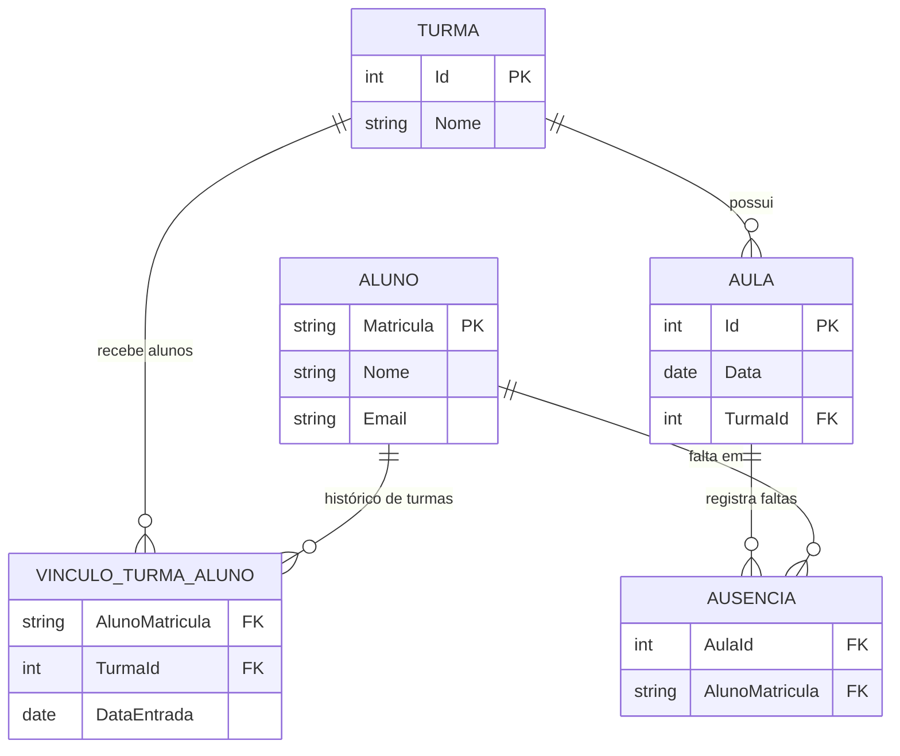

# Banco de dados e relacionamentos

## Visão geral

O sistema usa um banco de dados **MySQL**, hospedado na nuvem (Aiven), acessado
via `MySql.Data.MySqlClient` com comandos SQL parametrizados escritos à mão
(não há um ORM como Entity Framework — cada consulta é uma string SQL dentro
de um `Repositories/*.cs`, ver
[01-arquitetura-do-sistema.md](01-arquitetura-do-sistema.md)).

A string de conexão fica em `App.config`, lida uma única vez por cada
repositório:

```csharp
private readonly string connectionString =
    ConfigurationManager.ConnectionStrings["MyDbConn"].ConnectionString;
```

## As cinco tabelas

O esquema é enxuto — cinco tabelas — mas a relação entre elas carrega decisões
de modelagem importantes, explicadas depois do diagrama.

| Tabela | Campos (inferidos do código) | Chave primária |
|---|---|---|
| `Turma` | `Id`, `Nome` | `Id` |
| `Aluno` | `Matricula`, `Nome`, `Email` | `Matricula` |
| `VinculoTurmaAluno` | `AlunoMatricula`, `TurmaId`, `DataEntrada` | composta (não exposta pelo código, mas conceitualmente `AlunoMatricula + DataEntrada`) |
| `Aula` | `Id`, `Data`, `TurmaId` | `Id` |
| `Ausencia` | `AulaId`, `AlunoMatricula` | composta (`AulaId + AlunoMatricula`) |

## Diagrama entidade-relacionamento



## As relações, uma a uma

### `Turma` 1—N `Aula`

A relação mais simples do sistema: toda aula pertence a exatamente uma turma
(`Aula.TurmaId`). Uma turma pode ter zero ou várias aulas registradas — uma
aula só existe no banco depois que uma lista de presença é importada para
aquela turma (ver
[04-fluxo-de-dados-e-regras-de-negocio.md](04-fluxo-de-dados-e-regras-de-negocio.md)).

```csharp
// Repositories/AulaRepository.cs
string query = @"
    INSERT INTO Aula (Data, TurmaId)
    VALUES (@data, @turmaId);
    SELECT LAST_INSERT_ID();";
```

### `Turma` N—M `Aluno`, através de `VinculoTurmaAluno` — mas com uma pegada de **histórico**

Em um modelo relacional comum, "aluno pertence a uma turma" seria resolvido
com uma tabela de junção simples, onde cada par (aluno, turma) aparece **uma**
vez. Este sistema faz diferente, de propósito: `VinculoTurmaAluno` guarda
**uma linha por matrícula do aluno em uma turma**, e cada nova matrícula
(mudança de turma) **soma** uma nova linha, em vez de sobrescrever a
anterior. O "vínculo atual" de um aluno é sempre a linha com a **maior**
`DataEntrada` para aquela matrícula:

```sql
-- Repositories/AlunoRepository.cs — ObterPorTurma
SELECT a.Matricula, a.Nome, a.Email, v.TurmaId
FROM Aluno a
INNER JOIN VinculoTurmaAluno v ON a.Matricula = v.AlunoMatricula
WHERE v.TurmaId = @turmaId
  AND v.DataEntrada = (
      SELECT MAX(subM.DataEntrada)
      FROM VinculoTurmaAluno subM
      WHERE subM.AlunoMatricula = a.Matricula
  )
```

**Por que fazer assim?** Porque o cálculo de frequência precisa saber, para
cada falta registrada, **em qual turma o aluno estava naquela data** — se um
aluno troca de turma no meio do semestre, as faltas que ele teve na turma
antiga não podem contar (nem deixar de contar) baseadas na turma em que ele
está *hoje*. É por isso que a consulta de frequência filtra explicitamente
pela `DataEntrada` do vínculo:

```sql
-- Repositories/AlunoRepository.cs — ObterPerfilAluno
COALESCE((
    SELECT COUNT(*)
    FROM Ausencia aus
    INNER JOIN Aula au_falta ON aus.AulaId = au_falta.Id
    WHERE aus.AlunoMatricula = a.Matricula
      AND au_falta.TurmaId = v.TurmaId
      AND au_falta.Data >= v.DataEntrada   -- só conta aulas depois que o aluno entrou
), 0) AS TotalFaltas
```

Essa é a decisão de modelagem menos óbvia do sistema, e vale destacar para
quem for ler o código pela primeira vez: **`VinculoTurmaAluno` não é uma
tabela de matrícula única, é um histórico de matrículas.**

### `Aula` N—M `Aluno`, através de `Ausencia` — mas guardando o **oposto** da presença

A segunda decisão de modelagem que chama atenção: a tabela `Ausencia` não
guarda "quem esteve presente" — ela guarda **quem faltou**. O sistema nunca
grava uma linha "aluno X presente na aula Y"; ele grava apenas "aluno X
ausente na aula Y". Presença, portanto, é **a ausência de um registro**, não
um registro positivo.

Essa escolha existe porque a fonte de dados real (a lista de chamada
importada em CSV) só contém quem estava presente — e o sistema converte isso
para faltas no momento da importação:

```csharp
// Servicos/ImportacaoService.cs — ImportarPresenca
List<string> ausentes = new List<string>();
foreach (var aluno in alunosDaTurma)
{
    if (!matriculasPresentes.Contains(aluno.Matricula))
        ausentes.Add(aluno.Matricula);   // quem não está no CSV de presença = ausente
}
```

**Consequência prática**: se o professor importar um CSV de presença
incompleto (faltando uma matrícula que na verdade estava presente), o sistema
não tem como saber a diferença entre "o aluno faltou" e "o professor esqueceu
de colocar o nome dele na lista" — os dois casos geram o mesmo registro em
`Ausencia`. Essa é uma limitação intrínseca do modelo, não um bug: qualquer
sistema de "presença por exceção" (comum em chamadas eletrônicas) tem essa
mesma característica.

## Integridade referencial: quem garante o quê

O esquema **depende de chaves estrangeiras** (`TurmaId`, `AlunoMatricula`,
`AulaId`) para fazer sentido, mas nem toda garantia vem do banco — várias são
reforçadas explicitamente pelo código da camada de repositório, especialmente
depois da revisão de integridade de dados (ver
[05-tratamento-de-erros-e-testes.md](05-tratamento-de-erros-e-testes.md)):

- **Excluir uma turma** (`TurmaRepository.Excluir`) precisa apagar, nesta
  ordem e dentro de uma única transação, as ausências das aulas da turma, as
  aulas da turma, os vínculos de aluno com a turma, e só então a turma — senão
  sobrariam registros "órfãos" (apontando para um `TurmaId` que não existe
  mais):

  ```csharp
  // Repositories/TurmaRepository.cs — Excluir (trecho)
  DELETE Ausencia FROM Ausencia
  INNER JOIN Aula ON Ausencia.AulaId = Aula.Id
  WHERE Aula.TurmaId = @turmaId;
  -- depois: DELETE FROM Aula WHERE TurmaId = @turmaId;
  -- depois: DELETE FROM VinculoTurmaAluno WHERE TurmaId = @turmaId;
  -- só então: DELETE FROM Turma WHERE Id = @id;
  ```

- **Excluir um aluno** (`AlunoRepository.Excluir`) precisa apagar suas faltas
  e seu vínculo com a turma antes de apagar o próprio cadastro, também numa
  transação só.

- **Toda transação usa `BeginTransaction()` / `Commit()` / `Rollback()`**: se
  qualquer uma das exclusões falhar no meio do caminho, **nenhuma** é
  efetivada — o banco volta exatamente ao estado anterior à operação. É assim
  que o sistema evita, por exemplo, apagar as faltas de um aluno mas falhar
  ao apagar o cadastro dele, deixando o banco num estado inconsistente.

## Restrições de unicidade esperadas

Embora o script de criação das tabelas não faça parte deste repositório
(o banco já vem provisionado), o comportamento do código pressupõe:

- `Aluno.Matricula` é **única** (é a chave primária) — por isso a importação
  de CSV verifica antecipadamente se alguma matrícula do arquivo já existe no
  banco (`AlunoRepository.ContarMatriculasExistentes`), evitando depender só
  do banco rejeitar a duplicidade.
- `Turma.Nome` é tratado como único pela regra de negócio
  (`TurmaService.Adicionar`/`Atualizar` consultam antes de gravar), mesmo que
  o banco não tenha necessariamente essa restrição.

Se o banco **tiver** essas restrições como `UNIQUE KEY`, uma tentativa de
burlar a validação do serviço (por exemplo, duas requisições simultâneas)
ainda seria barrada pelo MySQL — e o erro (código `1062`) seria capturado e
traduzido pelo `MySqlExceptionTranslator` para uma mensagem amigável em vez de
travar a aplicação (ver
[05-tratamento-de-erros-e-testes.md](05-tratamento-de-erros-e-testes.md)).

## Resumo em uma frase por tabela

- **`Turma`** — as disciplinas/turmas cadastradas.
- **`Aluno`** — o cadastro de cada aluno, independente de turma.
- **`VinculoTurmaAluno`** — o *histórico* de qual turma cada aluno integrou, e
  desde quando.
- **`Aula`** — cada chamada (evento de presença) registrada para uma turma,
  em uma data.
- **`Ausencia`** — quem faltou em cada aula (a presença é implícita, por
  ausência de registro).
