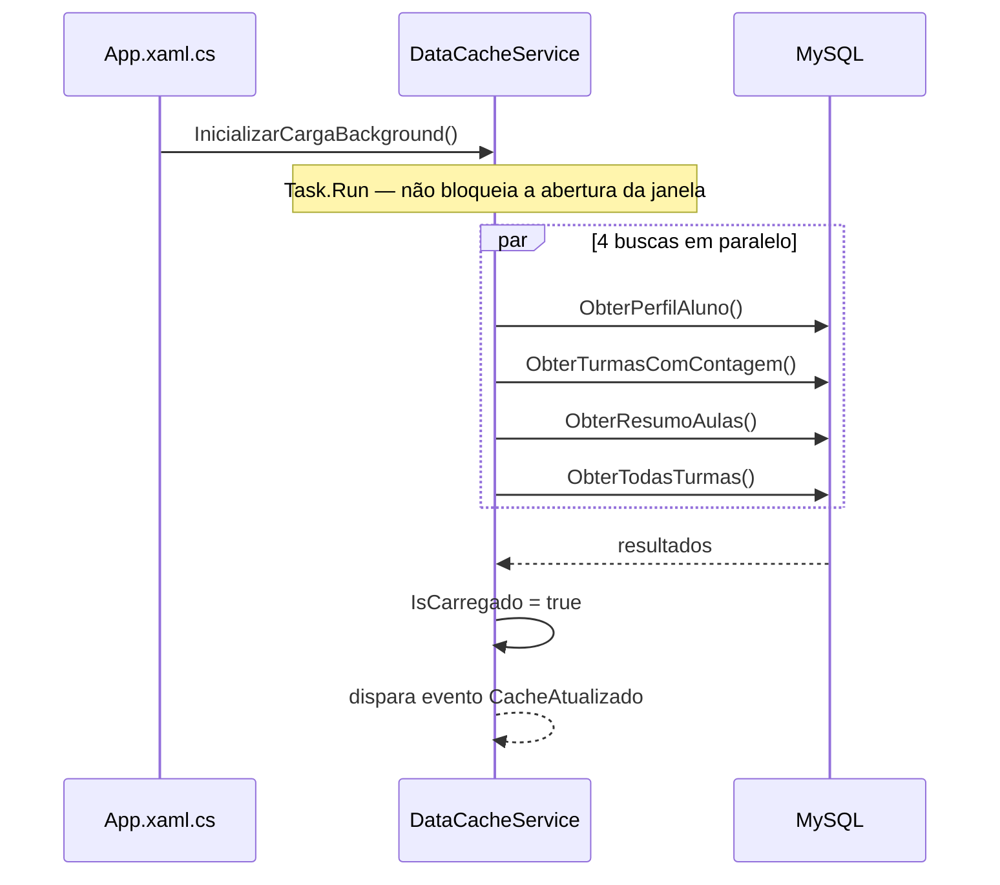
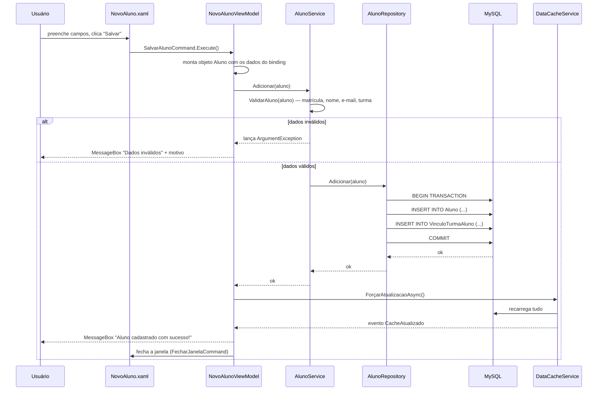
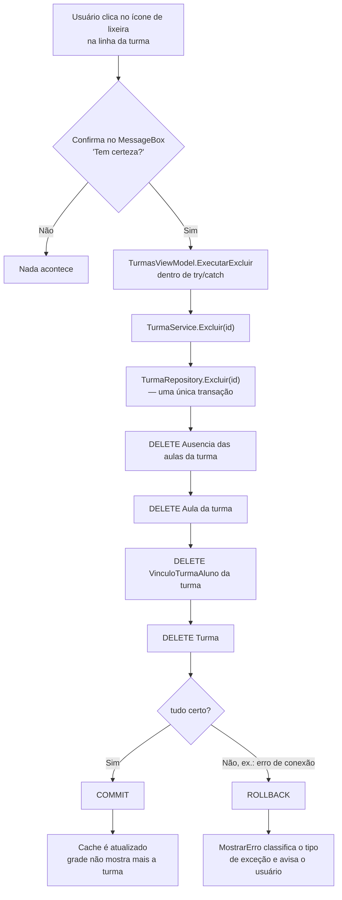
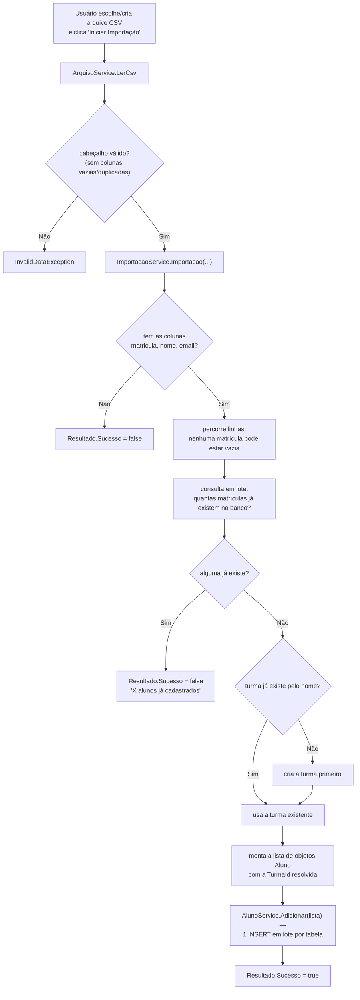
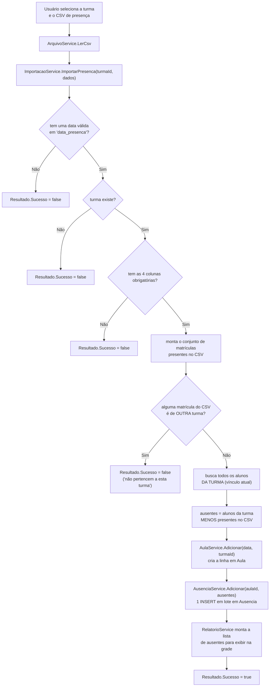
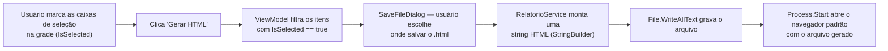

# Fluxo de dados e regras de negócio

Este documento acompanha, passo a passo, o caminho completo de cada operação
importante do sistema — do clique do usuário até o banco de dados, e de volta.
Pressupõe a leitura prévia de
[01-arquitetura-do-sistema.md](01-arquitetura-do-sistema.md) (as camadas) e
[03-banco-de-dados-e-relacionamentos.md](03-banco-de-dados-e-relacionamentos.md)
(as tabelas envolvidas).

## 1. Inicialização do sistema



A janela principal (`BaseWindow`) já abre e mostra a tela de Início
imediatamente; as telas individuais aguardam o cache ficar pronto
(`while (!DataCacheService.IsCarregado) await Task.Delay(100);`) antes de
exibir dados, evitando que o aplicativo pareça "travado" enquanto busca no
banco.

## 2. Cadastrar um registro simples (exemplo: novo aluno)



**Onde cada regra mora:**

- **Validação de formato/obrigatoriedade** → `AlunoService.ValidarAluno`
  (matrícula, nome, e-mail em formato válido, turma selecionada).
- **Persistência + consistência entre duas tabelas** (`Aluno` e
  `VinculoTurmaAluno`) → `AlunoRepository.Adicionar`, dentro de uma
  transação.
- **Atualização da tela e de todas as outras telas abertas** → o par
  `ForçarAtualizacaoAsync()` / evento `CacheAtualizado`.

O mesmo padrão (validar no Serviço → persistir no Repositório → atualizar o
cache → fechar o popup) se repete em **todos** os cadastros e edições do
sistema: `NovaTurmaViewModel`, `EditarAlunoViewModel`, `EditarTurmaViewModel`.

## 3. Excluir um registro — e por que precisa de mais cuidado

Excluir não é só "apagar uma linha": é preciso decidir o que fazer com tudo o
que depende daquele registro. O fluxo de exclusão de turma ilustra bem:



A confirmação antes de excluir (`MessageBox.Show(..., MessageBoxButton.YesNo,
...)`) é a primeira barreira; a transação no banco é a segunda — mesmo que o
usuário confirme, a operação só é considerada concluída se **todas** as
exclusões dependentes funcionarem.

## 4. Importação de cadastro de alunos via CSV

Esta é a rotina de negócio mais elaborada do sistema, porque precisa lidar
com um arquivo externo, decidir entre criar uma turma nova ou usar uma
existente, e validar **cada linha** do arquivo antes de gravar qualquer
coisa.



O ponto mais importante deste fluxo — e que foi corrigido na revisão de
consistência de dados — é que **`ImportarCadastroViewModel` só fecha a janela
e atualiza o cache se `resultado.Sucesso` for `true`**:

```csharp
// ViewModel/Popups/ImportarCadastroViewModel.cs
ResultadoImportacaoCadastro resultado = _importacaoService.Importacao(nomeDaTurma, dadosCsv, DataEntrada);

if (!resultado.Sucesso)
{
    MessageBox.Show(resultado.Mensagem, "Não foi possível importar", MessageBoxButton.OK, MessageBoxImage.Warning);
    return;   // mantém o popup aberto, não mexe no cache
}

await DataCacheService.ForçarAtualizacaoAsync();
MessageBox.Show(resultado.Mensagem, "Importação concluída", MessageBoxButton.OK, MessageBoxImage.Information);
_fecharJanela?.Invoke();
```

## 5. Importação de presença (lista de chamada) via CSV



Note como a lógica de "quem faltou" (passo `J`) é pura comparação de
conjuntos em memória (`HashSet<string>` de presentes vs. lista de matrículas
da turma) — nenhuma consulta SQL calcula ausência diretamente; é a regra de
negócio da camada de Serviço que faz essa subtração, exatamente pelo motivo
explicado em
[03-banco-de-dados-e-relacionamentos.md](03-banco-de-dados-e-relacionamentos.md)
(o banco só guarda faltas, nunca presenças).

## 6. Geração de relatórios em HTML

Os três relatórios (`RelatorioPorAluno`, `RelatorioPorAula`,
`RelatorioPorTurma` em `Servicos/RelatorioService.cs`) seguem o mesmo
molde:



O HTML é montado inteiramente em C# com `StringBuilder` (sem nenhum motor de
*template*) e cada valor inserido no meio do HTML passa por
`WebUtility.HtmlEncode(...)` — isso evita que um nome de aluno com caracteres
especiais (`<`, `&`, aspas) quebre a estrutura da página gerada.

## 7. Dois estilos de sinalização de erro convivendo no sistema

Vale explicar essa diferença porque ela aparece em vários lugares do código:

| Estilo | Onde é usado | Como o ViewModel reage |
|---|---|---|
| **Exceção** (`throw`) | Cadastro/edição/exclusão simples (`AlunoService`, `TurmaService`, `AulaService`) | `try { ... } catch (Exception ex) { MostrarErro(...) }` |
| **Objeto de resultado** (`Sucesso` + `Mensagem`) | Importações de CSV (`ImportacaoService`) | `if (!resultado.Sucesso) { mostra a mensagem; não continua }` |

A importação usa o padrão de resultado porque uma falha ali (ex.: "3
matrículas já existem") **não é excepcional** — é um resultado esperado e
comum do dia a dia de quem importa planilhas, então o código trata isso como
um fluxo normal, não como uma exceção. Já uma falha ao gravar um único
cadastro (ex.: o banco caiu no meio da operação) é, de fato, uma situação
excepcional — daí o uso de exceções nesse caso. Essa distinção (erro esperado
vs. erro excepcional) é uma prática comum em engenharia de software e está
detalhada, junto com a classificação de cada tipo de exceção, em
[05-tratamento-de-erros-e-testes.md](05-tratamento-de-erros-e-testes.md).
