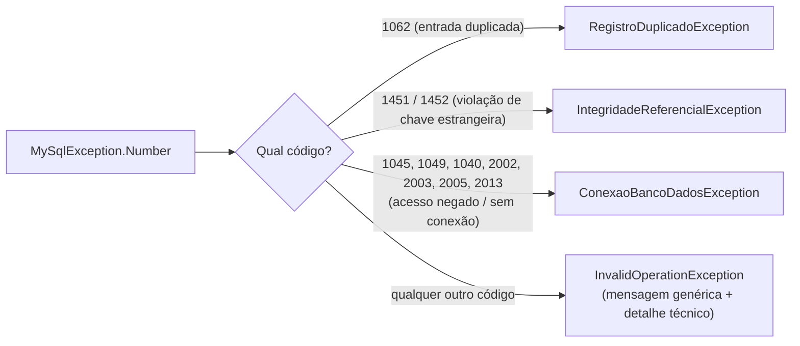
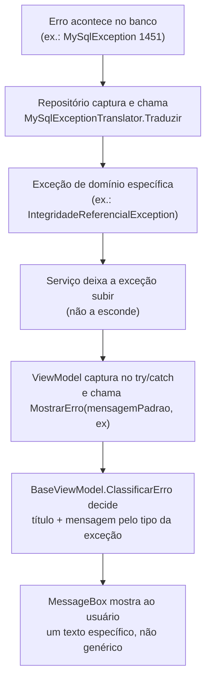

# Tratamento de erros e testes de integridade/consistência

## O problema que este mecanismo resolve

Antes desta revisão, praticamente todo erro do sistema — desde "e-mail em
formato inválido" até "o servidor do banco caiu" — chegava ao usuário com a
mesma cara: uma `MessageBox` genérica dizendo algo como *"Não foi possível
salvar. Verifique a conexão e tente novamente."* Isso é ruim por dois
motivos: (1) o usuário não sabe o que realmente aconteceu nem o que fazer a
respeito, e (2) alguns pontos do código sequer capturavam a exceção — um erro
podia derrubar a aplicação inteira sem aviso nenhum.

Este documento explica a solução adotada: **exceções de domínio próprias**,
um **tradutor** que interpreta os erros vindos do MySQL, e um
**classificador central** que decide qual título e qual mensagem mostrar para
cada tipo de problema.

## As quatro exceções de domínio

Criadas em `Excecoes/`, cada uma representa uma categoria de problema
possível ao gravar dados:

| Exceção | Quando acontece | Exemplo real |
|---|---|---|
| `RegistroDuplicadoException` | Uma operação tentaria gravar algo que já existe | Cadastrar uma turma com um nome já usado |
| `IntegridadeReferencialException` | Uma operação violaria uma dependência entre tabelas | Tentar excluir algo que ainda tem vínculos ativos |
| `RegistroNaoEncontradoException` | O registro que se tenta editar/excluir não existe mais | Dois usuários tentam excluir o mesmo aluno ao mesmo tempo |
| `ConexaoBancoDadosException` | Falha de rede, servidor fora do ar ou credenciais inválidas | Sem conexão com a internet no momento do salvamento |

Todas herdam de `Exception` e têm dois construtores (com e sem exceção
interna), seguindo a convenção padrão do .NET:

```csharp
// Excecoes/RegistroDuplicadoException.cs
public class RegistroDuplicadoException : Exception
{
    public RegistroDuplicadoException(string mensagem) : base(mensagem) { }
    public RegistroDuplicadoException(string mensagem, Exception excecaoInterna) : base(mensagem, excecaoInterna) { }
}
```

## O tradutor: de código de erro do MySQL para exceção de domínio

O MySQL comunica cada tipo de falha através de um **número de erro**
(`MySqlException.Number`). `Repositories/MySqlExceptionTranslator.cs`
mapeia os números mais relevantes para o sistema em uma das quatro exceções
acima:



```csharp
// Repositories/MySqlExceptionTranslator.cs (trecho)
public static Exception TraduzirPorNumero(int numeroErro, string mensagemOriginal, string contexto, Exception excecaoInterna = null)
{
    switch (numeroErro)
    {
        case ErroEntradaDuplicada:
            return new RegistroDuplicadoException(
                $"Já existe {contexto} cadastrado com esses dados. ...", excecaoInterna);

        case ErroLinhaReferenciadaPai:
        case ErroLinhaReferenciadaFilho:
            return new IntegridadeReferencialException(
                $"Não é possível concluir esta operação em {contexto} porque existem outros registros vinculados a ele(a)...", excecaoInterna);
        // ...
    }
}
```

O método principal, `Traduzir(MySqlException, contexto)`, é o que os
repositórios chamam de verdade; `TraduzirPorNumero(int, ...)` é uma versão
**testável separadamente**, que recebe só o número do erro — assim os testes
automatizados conseguem verificar cada cenário sem precisar de uma conexão
real com o banco (nem de um jeito de "forçar" o MySQL a falhar de propósito).

Todos os repositórios (`AlunoRepository`, `TurmaRepository`,
`AulaRepository`, `AusenciaRepository`) usam o tradutor tanto ao abrir a
conexão quanto ao executar comandos:

```csharp
// Repositories/AlunoRepository.cs
private static void AbrirConexao(MySqlConnection conn, string contexto)
{
    try { conn.Open(); }
    catch (MySqlException ex) { throw MySqlExceptionTranslator.Traduzir(ex, contexto); }
}
```

## O classificador central: `BaseViewModel.MostrarErro`

Em vez de cada ViewModel decidir "na mão" qual título mostrar para qual
exceção, essa decisão foi centralizada em `ViewModel/Base/BaseViewModel.cs`.
Assim, qualquer novo ViewModel que precisar mostrar um erro ganha esse
comportamento automaticamente, sem duplicar lógica:

```csharp
internal static void ClassificarErro(Exception excecao, string mensagemPadrao, out string titulo, out string mensagem)
{
    if (excecao is RegistroDuplicadoException)      { titulo = "Registro duplicado";      mensagem = excecao.Message; }
    else if (excecao is IntegridadeReferencialException) { titulo = "Ação bloqueada";      mensagem = excecao.Message; }
    else if (excecao is RegistroNaoEncontradoException)  { titulo = "Registro não encontrado"; mensagem = excecao.Message; }
    else if (excecao is ConexaoBancoDadosException)      { titulo = "Falha de conexão";    mensagem = excecao.Message; }
    else if (excecao is ArgumentException)               { titulo = "Dados inválidos";     mensagem = excecao.Message; }
    else { titulo = "Erro"; mensagem = mensagemPadrao ?? "Ocorreu um erro inesperado. Tente novamente."; }
}
```

Qualquer exceção **não reconhecida** (um bug inesperado, por exemplo) cai no
`else` final e usa a mensagem padrão definida pelo próprio ViewModel que
chamou — o usuário nunca vê um texto técnico bruto (`ex.Message` de uma
exceção do .NET) diretamente na tela, apenas as mensagens que o próprio
sistema escreveu.

Uso típico em um ViewModel — o código do "clique" nem precisa saber que tipo
de exceção pode acontecer, só precisa capturar e delegar:

```csharp
try
{
    _turmaService.Excluir(TurmaSelecionada.TurmaOriginal.Id);
    AtualizarCacheAposMudanca();
}
catch (Exception ex)
{
    MostrarErro("Não foi possível excluir a turma. Tente novamente.", ex);
}
```

Se `ex` for uma `IntegridadeReferencialException` (por exemplo), o usuário vê
"Ação bloqueada" + a explicação específica sobre vínculos existentes — não o
texto genérico "Não foi possível excluir a turma".

## Bugs de integridade corrigidos durante esta revisão

Vale documentar estes pontos porque eles ilustram, na prática, o que
"integridade e consistência de dados" significa neste projeto:

1. **`TurmaRepository.Excluir` não apagava os dados dependentes.** A
   confirmação mostrada ao usuário já prometia *"excluirá todos os dados
   associados a ela (alunos e chamadas)"*, mas o código só executava
   `DELETE FROM Turma`. Corrigido para excluir, numa única transação, as
   ausências das aulas da turma, as aulas, os vínculos de aluno e só então a
   turma (ver [03-banco-de-dados-e-relacionamentos.md](03-banco-de-dados-e-relacionamentos.md)).

2. **`AlunoRepository.Excluir` deixava faltas órfãs.** Apagava o aluno e seu
   vínculo com a turma, mas não a tabela `Ausencia` — deixando registros de
   falta apontando para uma matrícula que não existia mais. Corrigido da
   mesma forma, com uma transação.

3. **Exclusões sem tratamento de erro.** `TurmasViewModel.ExecutarExcluir` e
   `AlunosViewModel.ExecutarExcluir` chamavam o serviço diretamente, sem
   `try/catch` — qualquer falha ali derrubava a aplicação em vez de mostrar
   uma mensagem. Corrigido.

4. **Importações "bem-sucedidas" mesmo quando falhavam.** Os popups de
   importação de CSV fechavam a janela e atualizavam o cache mesmo quando
   `resultado.Sucesso` era `false` — escondendo do usuário que a operação
   não tinha realmente acontecido. Corrigido para só prosseguir quando
   `Sucesso == true` (ver
   [04-fluxo-de-dados-e-regras-de-negocio.md](04-fluxo-de-dados-e-regras-de-negocio.md)).

5. **Mensagem de e-mail enganosa.** O erro de e-mail inválido dizia exigir
   domínio `@univap.br`, mas a validação real (`ValidarEmailInstitucional`)
   nunca checou isso — só o formato geral do e-mail. Texto corrigido para não
   prometer uma regra que não existe.

## O projeto de testes automatizados

`TCC-Assiduidade.Testes/` é um projeto separado (MSTest) dentro da mesma
solução (`TCC Assiduidade.slnx`), com **47 testes** organizados por
responsabilidade:

| Arquivo | O que cobre |
|---|---|
| `AlunoServiceTestes.cs` | Validações de cadastro/edição de aluno (matrícula, nome, e-mail, turma) e os casos de `ValidarEmailInstitucional`. |
| `TurmaServiceTestes.cs` | Validações de nome obrigatório e identificadores válidos para turma. |
| `AulaServiceTestes.cs` | Data da aula não pode ser futura; turma precisa ser válida. |
| `MySqlExceptionTranslatorTestes.cs` | Cada código de erro do MySQL vira a exceção de domínio certa. |
| `ArquivoServiceTestes.cs` | Integridade de arquivos CSV: cabeçalho duplicado/vazio, arquivo inexistente, separador `,`/`;`, linha incompleta. |
| `ClassificacaoDeErrosTestes.cs` | Cada tipo de exceção gera o título e a mensagem corretos. |

### Por que os testes não precisam de um banco de dados real

Um detalhe importante de desenho: todos esses testes rodam **sem** conexão
com o MySQL, mesmo testando classes que, em uso normal, acessam o banco. Isso
é possível porque as validações de negócio (`ValidarAluno`, `if (turmaId <=
0)`, `if (dataAula > DateTime.Now)` etc.) são a **primeira** coisa que cada
método de Serviço faz — e todas lançam a exceção **antes** de qualquer
chamada ao Repositório:

```csharp
// Servicos/AlunoService.cs
public void Adicionar(Aluno aluno)
{
    if (aluno == null) return;
    ValidarAluno(aluno);            // <- lança aqui se algo estiver errado
    _alunoRepository.Adicionar(aluno);  // <- só chega aqui se passou na validação
}
```

Um teste como este, portanto, nunca chega a abrir uma conexão de verdade:

```csharp
// TCC-Assiduidade.Testes/AlunoServiceTestes.cs
[TestMethod]
public void Adicionar_ComMatriculaVazia_DeveLancarArgumentException()
{
    var aluno = AlunoValido();
    aluno.Matricula = "";

    var ex = Assert.ThrowsException<ArgumentException>(() => _service.Adicionar(aluno));
    StringAssert.Contains(ex.Message, "matrícula");
}
```

Para o `MySqlExceptionTranslator`, o próprio desenho da classe já separa a
parte que depende de uma `MySqlException` real (`Traduzir`) da parte pura,
testável isoladamente (`TraduzirPorNumero`):

```csharp
// TCC-Assiduidade.Testes/MySqlExceptionTranslatorTestes.cs
[TestMethod]
public void EntradaDuplicada_1062_DeveVirarRegistroDuplicadoException()
{
    var excecao = MySqlExceptionTranslator.TraduzirPorNumero(1062, "Duplicate entry", "a turma");
    Assert.IsInstanceOfType(excecao, typeof(RegistroDuplicadoException));
}
```

E para poder testar `BaseViewModel.ClassificarErro` — que é `internal`, ou
seja, só visível dentro do próprio assembly do sistema — o projeto principal
declara explicitamente que confia no projeto de testes:

```csharp
// Properties/AssemblyInfo.cs
[assembly: System.Runtime.CompilerServices.InternalsVisibleTo("TCC_Assiduidade.Testes")]
```

### Como rodar os testes

Pelo **Test Explorer** do Visual Studio (`Testar > Executar Todos os
Testes`), ou pela linha de comando:

```bash
vstest.console.exe "TCC-Assiduidade.Testes\bin\Debug\TCC_Assiduidade.Testes.dll"
```

Resultado esperado (situação no momento desta documentação):

```
Total de testes: 47
     Aprovados: 47
```

## Resumo do ciclo completo


