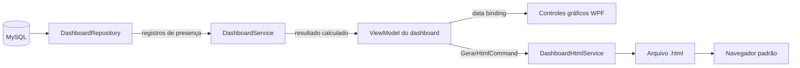
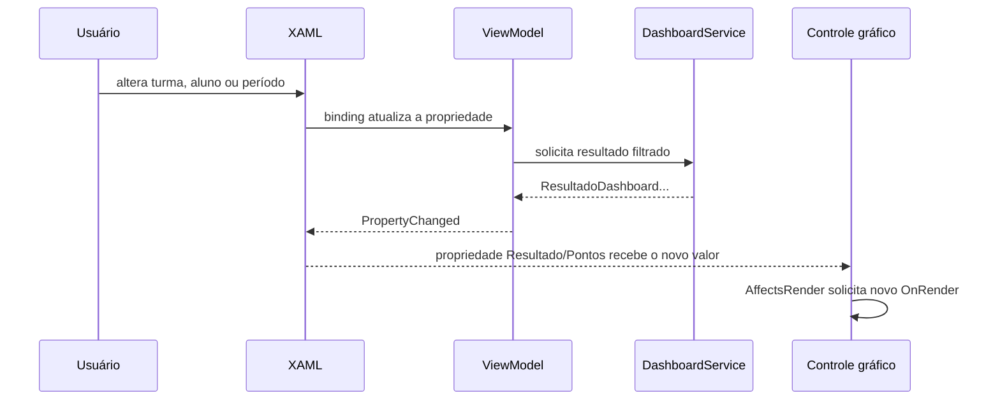
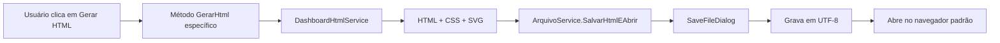
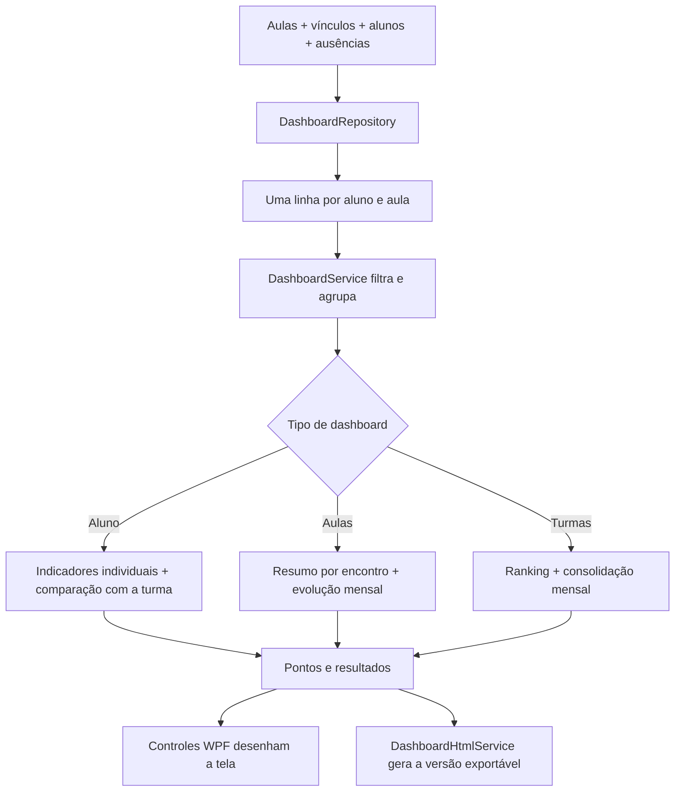

# Dashboards e geração de gráficos

## Visão geral

O sistema possui três dashboards analíticos — **Alunos**, **Aulas** e
**Turmas** — que transformam os registros de aulas e ausências em percentuais,
indicadores, rankings e séries temporais. A mesma informação pode ser vista na
interface WPF e exportada como um arquivo HTML aberto no navegador.

Embora os dois resultados tenham aparência semelhante, eles são produzidos por
dois mecanismos diferentes:

- na aplicação, controles WPF próprios desenham os gráficos diretamente com
  `DrawingContext`;
- no arquivo exportado, `DashboardHtmlService` recria os gráficos com HTML,
  CSS e SVG.

Não existe uma biblioteca externa de gráficos nem uma captura da tela. As duas
representações recebem os mesmos objetos calculados por `DashboardService` e
os renderizam de acordo com o meio de saída.



## 1. Origem dos dados

### Uma linha por aluno e aula

`Repositories/DashboardRepository.cs` executa uma consulta que combina cinco
elementos do modelo de dados:

- `Aula`, para obter a data e a turma do encontro;
- `Turma`, para obter o nome exibido nos filtros e gráficos;
- `VinculoTurmaAluno`, para descobrir quais alunos pertenciam à turma na data
  da aula;
- `Aluno`, para obter matrícula e nome;
- `Ausencia`, para distinguir presença de falta.

O resultado é convertido em uma lista de `RegistroFrequenciaDashboard`. Cada
objeto representa a situação de **um aluno em uma aula**:

```csharp
public class RegistroFrequenciaDashboard
{
    public int AulaId { get; set; }
    public DateTime Data { get; set; }
    public int TurmaId { get; set; }
    public string Turma { get; set; }
    public string Matricula { get; set; }
    public string Aluno { get; set; }
    public bool Presente { get; set; }
}
```

O banco armazena apenas ausências. Por isso, a consulta usa `LEFT JOIN` com
`Ausencia` e deriva a presença pela inexistência de uma falta:

```sql
CASE WHEN aus.AlunoMatricula IS NULL THEN 1 ELSE 0 END AS Presente
```

Essa regra é a base de todos os indicadores: se existe uma linha de ausência
para o aluno naquela aula, `Presente` é `false`; caso contrário, é `true`.

### Respeito ao histórico de vínculos

A consulta não usa simplesmente o vínculo atual do aluno. Ela considera apenas
vínculos cuja `DataEntrada` seja anterior ou igual à data da aula e escolhe o
vínculo mais recente disponível até aquele momento:

```sql
v.DataEntrada <= au.Data
AND v.DataEntrada = (
    SELECT MAX(v2.DataEntrada)
    FROM VinculoTurmaAluno v2
    WHERE v2.AlunoMatricula = v.AlunoMatricula
      AND v2.DataEntrada <= au.Data
)
```

Assim, uma transferência posterior não reescreve o passado: uma aula antiga
continua associada à turma em que o aluno estava naquela data. O `DISTINCT` da
consulta evita duplicações no conjunto final.

## 2. Carregamento e transformação

Ao entrar na Central de Dashboards, `DashboardsViewModel` cria uma única
instância de `DashboardService`. Essa instância é compartilhada pelos três
dashboards enquanto a central permanece aberta.

Na primeira tela acessada, `CarregarDadosAsync` consulta o banco em uma tarefa
de segundo plano:

```csharp
public async Task CarregarDadosAsync()
{
    if (_dadosCarregados)
        return;

    _registros = await Task.Run(
        () => _dashboardRepository.ObterRegistrosFrequencia());
    _dadosCarregados = true;
}
```

As próximas telas reutilizam a lista em memória. Isso evita repetir a mesma
consulta ao alternar entre Alunos, Aulas e Turmas. Consequentemente, os dados
formam um retrato do momento em que a central foi carregada; para consultar
alterações posteriores do banco, é necessário sair da Central de Dashboards e
abri-la novamente.

O intervalo inicial dos filtros é definido pela menor e pela maior data
existentes na lista. Os limites são inclusivos:

```csharp
(!dataInicio.HasValue || r.Data.Date >= dataInicio.Value.Date) &&
(!dataFim.HasValue || r.Data.Date <= dataFim.Value.Date)
```

## 3. Modelo comum dos gráficos

Todas as séries usam `PontoGraficoDashboard`:

```csharp
public class PontoGraficoDashboard
{
    public string Rotulo { get; set; }
    public double Valor { get; set; }
    public double? ValorSecundario { get; set; }
}
```

`Rotulo` identifica o ponto ou a barra (`set/26`, `Turma A`, `15/09`).
`Valor` guarda o percentual principal. `ValorSecundario` é opcional e aparece
no dashboard de aluno para comparar sua assiduidade com a média da turma.

O cálculo percentual é centralizado em `DashboardService`:

```csharp
private static double CalcularPercentual(int valor, int total)
{
    return total <= 0 ? 0 : Math.Round(valor * 100.0 / total, 1);
}
```

Em outras palavras:

```text
assiduidade (%) = quantidade de presenças × 100 / quantidade total de registros
```

O resultado é arredondado para uma casa decimal. Na renderização, valores são
limitados ao intervalo de 0% a 100% para impedir que uma entrada inválida seja
desenhada fora da área do gráfico.

## 4. Dashboard de alunos

O dashboard de alunos possui filtros de turma, aluno e período. Mudar a turma
reconstrói a lista de alunos; mudar o aluno ou uma data recalcula imediatamente
o resultado por meio dos `set` das propriedades do ViewModel.

Para o aluno selecionado, `ObterDashboardAluno` calcula:

| Indicador | Regra |
|---|---|
| Presenças | Quantidade de registros com `Presente == true`. |
| Ausências | Total de aulas menos as presenças. |
| Assiduidade | Presenças divididas pelo total de aulas do aluno no período. |
| Média da turma | Presenças de todos os registros da turma divididas pelo total de registros da turma. |
| Posição | Ranking decrescente de assiduidade; em empate, a matrícula define a ordem. |
| Situação | `Em risco` abaixo de 75%; `Atenção` de 75% até menos de 85%; `Regular` a partir de 85%. |

A evolução é agrupada por mês. Cada ponto contém duas séries:

- `Valor`: assiduidade mensal do aluno;
- `ValorSecundario`: assiduidade mensal da turma.

Isso permite que `DashboardLineChart` desenhe a linha principal em azul e a
comparação com a turma em verde.

Cada opção de aluno conserva também o `TurmaId`. Assim, se uma matrícula
aparecer no histórico de mais de uma turma, as opções são diferenciadas pelo
nome da turma e `ObterDashboardAluno` filtra pela combinação **matrícula +
turma**. A assiduidade individual, a média, o ranking e a série comparativa
permanecem no mesmo recorte, sem misturar períodos anteriores a uma
transferência.

## 5. Dashboard de turmas

O dashboard de turmas aceita uma turma específica ou a opção **Todas as
turmas**, além do período. `ObterDashboardTurmas` produz:

- assiduidade geral de todos os registros filtrados;
- número de turmas e alunos distintos analisados;
- quantidade de alunos cuja assiduidade ficou abaixo de 75%;
- ranking das turmas, ordenado do maior para o menor percentual;
- evolução mensal consolidada.

O ranking alimenta o gráfico de barras. Quando todas as turmas são escolhidas,
cada barra representa uma turma; quando uma turma específica é escolhida, o
gráfico contém somente aquela turma.

## 6. Dashboard de aulas

`ObterDashboardAulas` primeiro agrupa os registros por `AulaId`, data e turma.
Cada grupo se torna uma aula com número de presentes, total de alunos e
percentual de presença.

O resultado contém:

- presença média no período;
- total de aulas e total de ausências;
- melhor aula, escolhida pelo maior percentual e, em empate, pela data mais
  recente;
- aula que exige atenção, escolhida pelo menor percentual e, em empate, pela
  data mais antiga;
- as últimas 12 aulas, em ordem cronológica, para o gráfico de barras;
- evolução mensal de todas as aulas filtradas.

Limitar as barras às 12 aulas mais recentes preserva a legibilidade sem perder
a visão histórica mensal, que continua disponível no gráfico de linha.

## 7. Como os gráficos são desenhados no WPF

`View/Controls/DashboardCharts.cs` declara três controles que herdam
diretamente de `FrameworkElement`:

| Controle | Propriedade de dados | Representação |
|---|---|---|
| `DashboardDonutChart` | `Resultado` (`ResultadoDashboardBase`) | Proporção entre presenças e ausências. |
| `DashboardBarChart` | `Pontos` (`IEnumerable<PontoGraficoDashboard>`) | Comparação de até 12 percentuais. |
| `DashboardLineChart` | `Pontos` (`IEnumerable<PontoGraficoDashboard>`) | Evolução percentual; aceita uma segunda série opcional. |

O XAML passa o objeto ao controle usando *binding*:

```xml
<controls:DashboardDonutChart Resultado="{Binding Resultado}"/>
<controls:DashboardBarChart Pontos="{Binding Ranking}"/>
<controls:DashboardLineChart Pontos="{Binding Evolucao}"
                             MostrarSerieSecundaria="True"/>
```

Essas entradas são `DependencyProperty` registradas com a opção
`AffectsRender`. Quando o *binding* entrega um novo resultado ou uma nova
coleção, o próprio WPF invalida o desenho, executa novamente `OnRender` e o
controle redesenha o gráfico. O `DataContext` continua reservado ao ViewModel
da tela, como nos demais controles do projeto.

### Gráfico de rosca

`DashboardDonutChart` soma presentes e ausentes, calcula o percentual de
presença e desenha:

1. um círculo de fundo;
2. um arco verde proporcional ao percentual (`percentual × 3,6` graus);
3. o percentual e a legenda no centro.

O caso de 100% usa um círculo completo, evitando a ambiguidade geométrica de
um arco cujo início e fim coincidem.

### Gráfico de barras

`DashboardBarChart` mostra no máximo os 12 primeiros pontos recebidos. Cada
linha possui rótulo, trilho, preenchimento proporcional e valor textual. Os
rótulos com mais de 22 caracteres são abreviados.

A cor da barra também comunica a classificação:

- vermelho: abaixo de 75%;
- amarelo: de 75% até menos de 85%;
- verde: 85% ou mais.

### Gráfico de linha

`DashboardLineChart` usa uma escala fixa de 0% a 100%, com linhas-guia em 0,
25, 50, 75 e 100%. A posição vertical de cada ponto é calculada a partir do
percentual; a posição horizontal é distribuída igualmente pela largura
disponível.

Para não sobrepor textos em séries longas, o controle exibe no máximo cerca de
oito rótulos intermediários, sempre preservando o último. Quando
`MostrarSerieSecundaria` está ativo e todos os pontos possuem
`ValorSecundario`, uma segunda polilinha é desenhada.

### Primitivas gráficas

`View/Controls/PrimitivasGraficas.cs` concentra as operações de baixo nível.
As fábricas seguem os nomes curtos já usados no projeto (`Cor`, `Pincel`,
`Caneta`, `CanetaArredondada` e `Texto`); as operações que alteram o
`DrawingContext` deixam a ação explícita (`DesenharLinha`, `DesenharCirculo`,
`DesenharRetanguloArredondado`, `DesenharTexto`, `DesenharPolilinha` e
`DesenharArco`). Pincéis e canetas são congelados com `Freeze()` quando
possível, reduzindo o custo de renderização e permitindo seu uso seguro pelo
sistema gráfico do WPF.

Se um controle não recebe dados ou não possui espaço mínimo para ser desenhado,
ele mostra a mensagem **“Sem dados para o período selecionado.”** em vez de
lançar uma exceção.

## 8. Atualização reativa da tela

Cada tela possui um ViewModel derivado de `DashboardBaseViewModel`. Os filtros
são propriedades ligadas em modo `TwoWay`; seus `set` chamam
`AtualizarDashboard()`. O novo `ResultadoDashboard...` dispara
`OnPropertyChanged` para as métricas e coleções derivadas.



Durante a consulta inicial, `MensagemEstado` informa que os dados estão sendo
carregados. Se o filtro não produzir registros, o serviço devolve
`TemDados == false` e uma mensagem específica. Erros de consulta ou exportação
passam pelo tratamento central de `BaseViewModel.MostrarErro`.

## 9. Exportação para HTML

Todos os ViewModels de dashboard herdam o comando `GerarHtmlCommand` de
`DashboardBaseViewModel`. O fluxo completo é:



Há um gerador para cada tipo de resultado:

- `GerarHtmlAluno`;
- `GerarHtmlAulas`;
- `GerarHtmlTurmas`.

Todos reaproveitam `RelatorioService.RelatorioBase` para o esqueleto do
documento e acrescentam estilos próprios. Os elementos visuais são recriados
da seguinte maneira:

| Visual | Implementação no HTML |
|---|---|
| Rosca | `conic-gradient` do CSS. |
| Barras | Elementos `div` com largura percentual. |
| Linha | SVG com grade, eixos, `polyline`, pontos e rótulos. |

As métricas, o período selecionado e a data de geração também são incluídos no
arquivo. Textos vindos dos dados — nome de aluno, turma e rótulos — passam por
`WebUtility.HtmlEncode`, impedindo que caracteres como `<`, `>` e `&` alterem a
estrutura do documento. Números usados no CSS e no SVG são formatados com
`InvariantCulture`, garantindo ponto decimal independentemente da configuração
regional do Windows.

A exportação só é permitida quando `TemDados` é verdadeiro. Cancelar o diálogo
de salvamento encerra o fluxo sem criar arquivo e sem exibir mensagem de
sucesso.

## 10. Navegação e organização das telas

O botão **Dashboards** da janela principal abre `DashboardsView` usando toda a
altura disponível. Dentro da central, três comandos de `DashboardsViewModel`
substituem `ConteudoAtual` por uma das views analíticas:

```text
DashboardsView
├── DashboardAlunosView
├── DashboardAulasView
└── DashboardTurmasView
```

Cada view instancia seu ViewModel e recebe a mesma instância de
`DashboardService`. O comando **Voltar** apenas define `ConteudoAtual = null`,
revelando novamente os três cartões da central.

## 11. Mapa dos arquivos envolvidos

| Arquivo ou pasta | Responsabilidade |
|---|---|
| `Repositories/DashboardRepository.cs` | Consulta SQL e criação dos registros de frequência. |
| `Modelos/Dashboard/` | Filtros, registros normalizados, pontos e resultados. |
| `Servicos/DashboardService.cs` | Filtros, agregações, percentuais, rankings e séries. |
| `Servicos/DashboardHtmlService.cs` | Documento exportável e gráficos em HTML/CSS/SVG. |
| `ViewModel/DashboardsViewModel.cs` | Navegação interna e serviço compartilhado. |
| `ViewModel/Dashboards/` | Estado, filtros, métricas e comandos das três telas. |
| `View/Dashboards/` | XAML, estilos e composição visual dos dashboards. |
| `View/Controls/DashboardCharts.cs` | Controles WPF de rosca, barras e linha. |
| `View/Controls/PrimitivasGraficas.cs` | Operações gráficas reutilizadas pelos controles. |
| `Servicos/ArquivoService.cs` | Diálogo, gravação do HTML e abertura no navegador. |

## Resumo do ciclo completo


